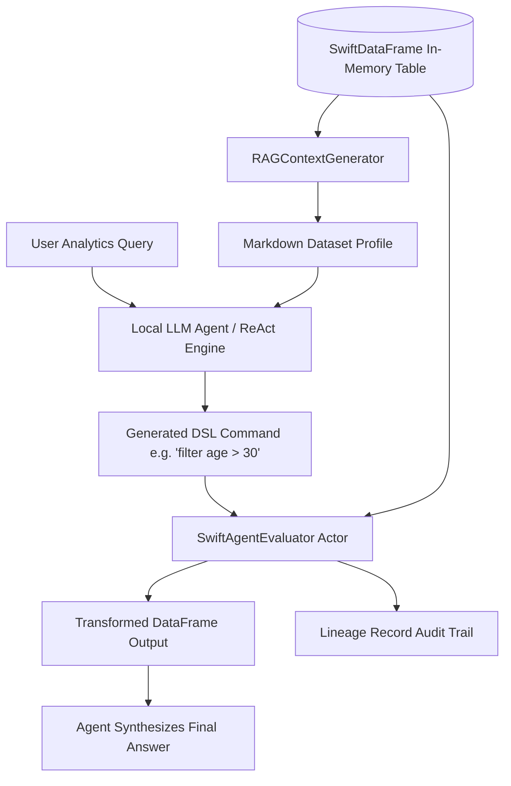

# Safe Swift REPL & RAG Context Generator

Execute dynamic Swift expressions in a sandboxed evaluation engine, trace immutable lineage audit trails, and summarize tabular DataFrame context for local LLM agents.

## Overview

Autonomous AI data analyst agents require two core capabilities when interacting with private local data:
1. **Sandboxed Code & Command Execution**: Safely filtering, grouping, projecting, and transforming tabular datasets without executing arbitrary unvetted shell scripts or system processes.
2. **Token-Efficient Context Summarization**: Compressing high-dimensional tables into structured, dense Markdown schema summaries that fit comfortably within LLM context windows.

`SwiftAgent` provides ``SwiftAgentEvaluator`` and ``RAGContextGenerator`` to bridge on-device large language models (`SwiftLLM`) with the native performance of ``SwiftDataFrame``.



---

## 1. Sandboxed REPL & DSL Command Evaluation

The ``SwiftAgentEvaluator`` is an actor-isolated engine that parses and executes high-level DSL commands on a `DataFrame`. Unlike raw interpreter bridges, it evaluates operations through a strongly typed AST (Abstract Syntax Tree), ensuring that memory safety, thread isolation, and data invariants are strictly preserved.

### Supported DSL Operations

| Command Pattern | Example Expression | AST Case | Description |
|:---|:---|:---|:---|
| **Filter** | `"filter Age > 30.0"` | `.filter(column, condition)` | Evaluates scalar thresholds (`>`, `<`, `>=`, `<=`, `==`, `!=`). |
| **Select** | `"select Product, Price"` | `.select(columns)` | Projects specific column subsets. |
| **GroupBy** | `"groupby Category mean Price"` | `.groupBy(column, agg, target)` | Computes aggregations (`mean`, `sum`, `min`, `max`, `count`). |
| **Sample** | `"sample 50"` | `.sample(n)` | Randomly samples rows deterministically. |
| **Head / Tail** | `"head 10"` / `"tail 5"` | `.head(n)` / `.tail(n)` | Slices initial or trailing records. |
| **Null Handling** | `"dropNulls"` / `"fillNulls Fare 0.0"` | `.dropNulls` / `.fillNulls` | Cleans or imputes missing scalar entries. |

### Execution Example

```swift
import Foundation
import SwiftDataFrame
import SwiftAgent

// 1. Initialize DataFrame
let rawDF = DataFrame(columns: [
    TypedColumn(name: "Department", values: ["Sales", "Engineering", "Sales", "Support", "Engineering"]),
    TypedColumn(name: "Salary", values: [75000.0, 120000.0, 82000.0, 58000.0, 135000.0]),
    TypedColumn(name: "TenureYears", values: [3, 5, 4, 1, 7])
])

// 2. Initialize actor evaluator
let evaluator = SwiftAgentEvaluator()

// 3. Execute sandboxed transformations
let highEarners = try await evaluator.evaluate(
    command: "filter Salary >= 80000.0",
    on: rawDF
)

let departmentSummary = try await evaluator.evaluate(
    command: "groupby Department mean Salary",
    on: highEarners
)

print(departmentSummary.summary())
```

---

## 2. Lineage Tracking & Immutable Audit Trails

When autonomous agents transform datasets over iterative multi-turn dialogues, tracking the provenance and step-by-step delta of the data is critical for compliance and verification.

``SwiftAgentEvaluator`` automatically captures each successful transformation as an immutable ``LineageRecord``:

```swift
// Inspect the execution trajectory
let auditTrail = await evaluator.lineage

for record in auditTrail {
    print("""
    [Step \(record.stepIndex)] \(record.operation)
      • Rows: \(record.inputRows) -> \(record.outputRows)
      • Executed At: \(record.timestamp)
    """)
}

// Reset trajectory between separate user tasks
await evaluator.clearLineage()
```

---

## 3. Tabular RAG Context Summarization

Large datasets cannot be pasted verbatim into an LLM context window without incurring prohibitive attention computation and context exhaustion. ``RAGContextGenerator`` extracts metadata, column typings, and dimensional boundaries to produce token-efficient Markdown profiles for prompt injection:

```swift
let contextGen = RAGContextGenerator()
let markdownProfile = contextGen.generateSummary(df: rawDF, name: "EmployeePayroll")

print(markdownProfile)
// Output:
// ## EmployeePayroll Profile
// - Rows: 5, Columns: 3
// - Columns: Department, Salary, TenureYears
```

Inject this profile directly into your system prompt so the language model understands available columns and schema constraints before generating transformation instructions.

---

## 4. End-to-End LLM Function Calling & ReAct Integration

Combine ``RAGContextGenerator``, ``SwiftAgentEvaluator``, and `SwiftLLM` to construct an autonomous tabular analyst:

```swift
import SwiftAgent
import SwiftDataFrame

public struct TabularAnalystTool: Sendable {
    private let evaluator: SwiftAgentEvaluator
    private var currentDataFrame: DataFrame

    public init(df: DataFrame) {
        self.evaluator = SwiftAgentEvaluator()
        self.currentDataFrame = df
    }

    /// Tool invocation callback conforming to ReActAgent tool schema
    public mutating func execute(command: String) async throws -> String {
        let transformed = try await evaluator.evaluate(command: command, on: currentDataFrame)
        self.currentDataFrame = transformed
        return "Command succeeded. Result dimensions: \(transformed.rowCount) rows x \(transformed.columnNames.count) columns."
    }

    public func datasetContext() -> String {
        RAGContextGenerator().generateSummary(df: currentDataFrame, name: "ActiveWorkspace")
    }
}
```

---

## 5. Safe Error Handling & Guardrails

The evaluation sandbox rejects unparseable strings, missing columns, or type mismatches early, throwing structured ``AgentError`` instances:

```swift
do {
    let result = try await evaluator.evaluate(command: "filter NonExistentCol > 10", on: rawDF)
} catch let AgentError.unparseable(cmd) {
    print("Agent emitted an invalid DSL syntax: \(cmd)")
} catch let AgentError.executionFailed(reason) {
    print("Execution rejected: \(reason)")
} catch {
    print("Unexpected error: \(error)")
}
```

---

## Topics

### Agent Components
- ``SwiftAgentEvaluator``
- ``RAGContextGenerator``
- ``LineageRecord``
- ``AgentError``
- ``AgentCommand``
