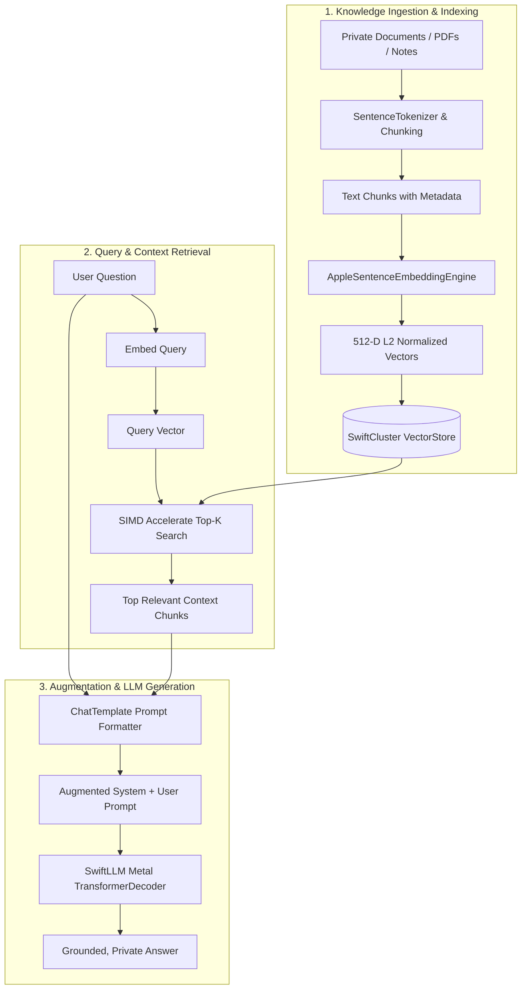

# Building On-Device RAG Pipelines

Construct privacy-preserving Retrieval-Augmented Generation workflows and autonomous knowledge agents on Apple Silicon.

## Overview

On-Device Retrieval-Augmented Generation (RAG) combines local vector similarity search with on-device large language models (LLMs) to answer questions grounded in private documents. By running the entire pipeline locally, user data never leaves the device, network latency is eliminated, and cloud API expenses are removed.



---

## 1. Document Chunking & Preprocessing

Effective retrieval depends on breaking large texts into concise, semantically coherent passages. `SwiftNLP` provides tokenizers to chunk documents without splitting sentences mid-thought:

```swift
import SwiftNLP

let document = """
SwiftSci is an accelerated scientific computing suite for Apple Silicon.
It provides high-performance modules for data frames, machine learning, clustering, and NLP.
The SwiftForecast module implements classical time series forecasting including ARIMA, ETS, and WAPE evaluation.
The SwiftLLM module enables on-device transformer inference using Metal and unified memory.
"""

// 1. Split document into clean sentences
let sentenceTokenizer = SentenceTokenizer()
let sentences = sentenceTokenizer.tokenize(text: document)

// 2. Group sentences into overlapping chunks (e.g. 2 sentences per chunk with 1 sentence overlap)
var chunks: [(id: String, text: String)] = []
let chunkSize = 2
let overlap = 1

var index = 0
var chunkId = 0
while index < sentences.count {
    let endIndex = min(index + chunkSize, sentences.count)
    let chunkText = sentences[index..<endIndex].joined(separator: " ")
    chunks.append((id: "chunk_\(chunkId)", text: chunkText))
    chunkId += 1
    index += (chunkSize - overlap)
}

print("Created \(chunks.count) overlapping text chunks.")
```

---

## 2. Choosing an Embedding Strategy

`SwiftNLP` provides two built-in embedding engines conforming to ``SentenceEmbeddingProvider``:

```swift
// Strategy A: Native Apple Neural Embeddings (512-D, High Semantic Accuracy)
let appleEngine = try AppleSentenceEmbeddingEngine(language: .english)

// Strategy B: Lightweight Offline Subword Hashing (128-D, Ultra-Low Latency)
let localEngine = LocalEmbeddingEngine(dimension: 128)
```

| Engine | Dimension | Dependencies | Best For |
|:---|:---:|:---:|:---|
| **`AppleSentenceEmbeddingEngine`** | 512 | Native Apple `NLEmbedding` | High-fidelity conceptual matching, complex sentence semantics. |
| **`LocalEmbeddingEngine`** | 128–512 | Zero (Pure Swift & SIMD) | Micro-memory environments, instant token/keyword hashing. |

---

## 3. Ingesting Chunks into VectorStore

Store the generated embeddings alongside chunk text and metadata into `SwiftCluster.VectorStore`:

```swift
import SwiftCluster

let vectorStore = VectorStore(metric: .cosineSimilarity)

// Generate embeddings in batch and index
for chunk in chunks {
    let embedding = try appleEngine.embed(chunk.text)
    vectorStore.add(
        id: chunk.id,
        vector: embedding,
        metadata: [
            "text": chunk.text,
            "document": "SwiftSci_Architecture.md"
        ]
    )
}

print("Indexed \(vectorStore.count) chunks into VectorStore.")
```

---

## 4. Retrieving Context with Score Thresholding

When a user submits a query, embed the question and query the vector store. Apply a **minimum similarity threshold** (e.g. `0.65`) to filter out irrelevant passages:

```swift
let userQuery = "Which module handles time series forecasting?"
let queryVector = try appleEngine.embed(userQuery)

// Search for Top-2 nearest chunks
let searchResults = vectorStore.search(query: queryVector, topK: 2)

// Filter by relevance threshold
let similarityThreshold = 0.65
let relevantMatches = searchResults.filter { $0.score >= similarityThreshold }

let retrievedContext: String
if relevantMatches.isEmpty {
    retrievedContext = "No sufficiently relevant documentation found."
} else {
    retrievedContext = relevantMatches.enumerated().map { idx, match in
        "[\(idx + 1)] \(match.metadata["text"] ?? "")"
    }.joined(separator: "\n\n")
}

print("Retrieved Context:\n\(retrievedContext)")
```

---

## 5. Assembling the Augmented Prompt with ChatTemplate

Use `SwiftNLP.ChatTemplate` to format the prompt according to your local model's specific chat schema (such as Llama 3 or Mistral), enforcing strict grounding rules to eliminate hallucinations:

```swift
import SwiftNLP

let systemInstruction = """
You are a factual, private documentation assistant.
Answer the user's question strictly and exclusively based on the Context provided below.
If the answer cannot be determined from the Context, state clearly: "I cannot find this information in the provided document."
Never hallucinate or assume facts not present in the Context.
"""

let userPrompt = """
Context:
\(retrievedContext)

Question:
\(userQuery)
"""

// Format prompt using Llama 3 instruct template
let template = ChatTemplate(format: .llama3)
let formattedPrompt = template.render(
    systemPrompt: systemInstruction,
    userPrompt: userPrompt
)

print("Formatted LLM Prompt:\n\(formattedPrompt)")
```

---

## 6. On-Device Generation with SwiftLLM

Feed the formatted prompt into `SwiftLLM`'s `TransformerDecoder` for Metal-accelerated inference with KV-cache reuse:

```swift
import SwiftLLM

// Initialize local model decoder (e.g. Llama 3 8B or Mistral 7B)
// let decoder = try TransformerDecoder(checkpointPath: modelURL)
// let responseStream = try await decoder.generate(prompt: formattedPrompt, maxTokens: 256)
// for await token in responseStream {
//     print(token, terminator: "")
// }
```

---

## 7. Agentic RAG with SemanticVectorMemory & ReActAgent

Rather than performing a single static retrieval step, autonomous agents built with `SwiftAgent` can use `SemanticVectorMemory` (backed by `HNSWIndex`) or call `VectorStore` as an explicit tool:

```swift
import SwiftAgent
import SwiftCluster

// Define a Knowledge Search Tool for the ReActAgent
let knowledgeSearchTool = AgentToolV2(
    name: "search_knowledge_base",
    description: "Searches private documentation for relevant information matching a query.",
    parameters: [
        AgentParameter(name: "query", type: .string, description: "The search query keywords.")
    ]
) { params in
    guard let query = params["query"] as? String else {
        return "Error: missing query parameter."
    }
    let queryVec = try appleEngine.embed(query)
    let hits = vectorStore.search(query: queryVec, topK: 2)
    return hits.map { $0.metadata["text"] ?? "" }.joined(separator: "\n---\n")
}

// Ingest long-term semantic conversation memory
let memory = SemanticVectorMemory(metric: .cosineSimilarity) { text in
    try await appleEngine.embed(text)
}

try await memory.record(
    content: "User inquired about SwiftForecast ARIMA models on October 15.",
    role: "system",
    metadata: ["topic": "forecasting"]
)
```

---

## 8. Tabular Dataset RAG with RAGContextGenerator

When an AI agent needs to analyze or answer questions regarding tabular datasets (`DataFrame`), use `RAGContextGenerator` to create token-efficient Markdown summaries containing column schemas, row counts, and structural dimensions:

```swift
import SwiftDataFrame
import SwiftAgent

let df = try DataFrame(columns: [
    TypedColumn(name: "Product", values: ["Widget A", "Widget B", "Widget C"]),
    TypedColumn(name: "Price", values: [19.99, 29.99, 49.99]),
    TypedColumn(name: "Stock", values: [100, 45, 12])
])

let generator = RAGContextGenerator()
let datasetSummary = generator.generateSummary(df: df, name: "InventoryDataset")

print("RAG Prompt Context:\n\(datasetSummary)")
// Output:
// ## InventoryDataset Profile
// - Rows: 3, Columns: 3
// - Columns: Product, Price, Stock
```

---

## Topics

### Agent Components
- ``SwiftAgentEvaluator``
- ``AgentMemory``
- ``SemanticVectorMemory``
- ``SlidingWindowMemory``
- ``RAGContextGenerator``
- ``ReActAgent``
