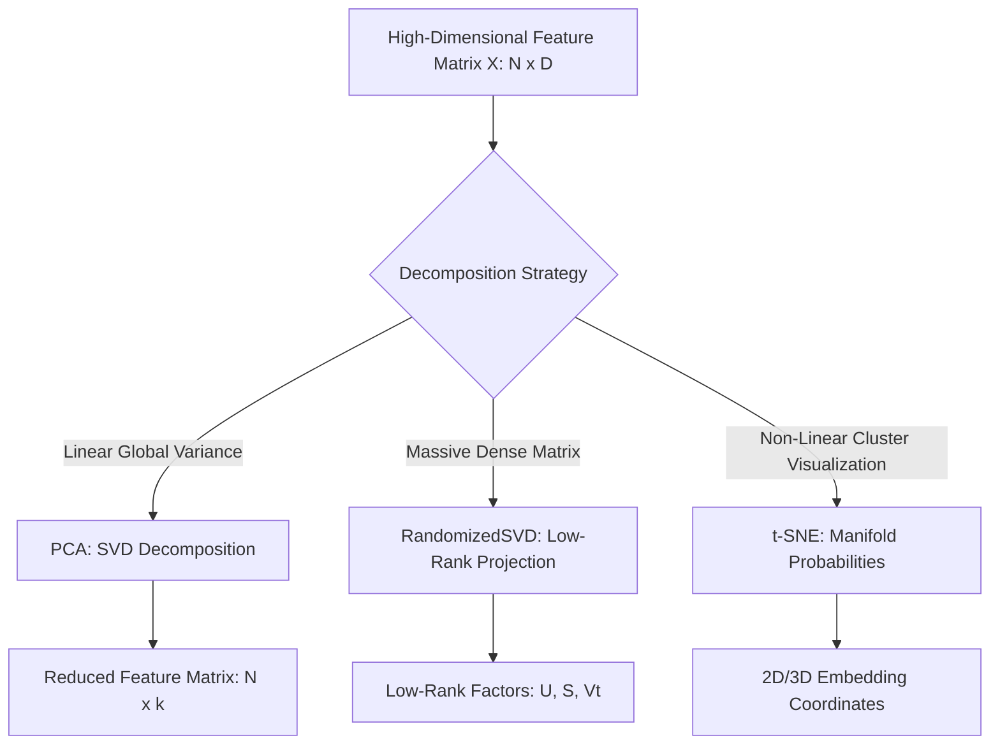

# Dimensionality Reduction & Manifold Learning

Reduce high-dimensional feature spaces, uncover latent structures, and visualize complex datasets using PCA, Randomized SVD, and t-SNE.

## Overview

High-dimensional datasets frequently suffer from the "curse of dimensionality"—excessive noise, collinearity, high memory footprints, and difficulty in visualization. `SwiftCluster` provides a suite of linear and non-linear dimensionality reduction algorithms optimized for Apple Silicon unified memory:

1. **``PCA``**: Exact Principal Component Analysis using singular value decomposition (SVD) with automatic CPU and UMA GPU hardware routing.
2. **``RandomizedSVD``**: Ultra-fast approximate rank-$k$ matrix decomposition following the Halko et al. (2011) algorithm for massive datasets.
3. **``TSNE``**: Non-linear manifold learning minimizing Kullback-Leibler divergence for 2D and 3D cluster visualization.



---

## 1. Principal Component Analysis (PCA)

Principal Component Analysis finds orthogonal projection axes (principal components) that maximize the variance of the data. 

### Fitting and Transforming

```swift
import SwiftCluster

// 1. Initialize PCA to extract 3 principal components
let pca = PCA(nComponents: 3, device: .auto)

// 2. Fit and project the data matrix [N rows x D columns]
let X_reduced = try await pca.fitTransform(featureMatrix)

// 3. Inspect explained variance ratios
if let ratios = pca.explainedVarianceRatio {
    print("Explained variance per component: \(ratios)")
    let cumulative = ratios.reduce(0.0, +)
    print("Total captured variance: \(String(format: "%.2f%%", cumulative * 100))")
}
```

### Choosing Optimal Components (Scree Analysis)

Analyze the cumulative variance to select the minimal number of components capturing $90\%+$ of total data variance:

```swift
var cumulativeSum = 0.0
for (index, ratio) in (pca.explainedVarianceRatio ?? []).enumerated() {
    cumulativeSum += ratio
    print("PC\(index + 1): \(String(format: "%.3f", ratio)) | Cumulative: \(String(format: "%.1f%%", cumulativeSum * 100))")
    if cumulativeSum >= 0.90 {
        print(">> Recommended cutoff: \(index + 1) components")
        break
    }
}
```

---

## 2. Approximate Low-Rank SVD (`RandomizedSVD`)

When factorizing massive matrices where $k \ll \min(M, N)$, standard deterministic LAPACK SVD ($O(MN^2)$) becomes memory- and compute-prohibitive. ``RandomizedSVD`` computes an approximate rank-$k$ factorization $X \approx U \cdot \text{diag}(S) \cdot V^T$ in $O(MNk)$ using randomized sketching:

```swift
import SwiftCluster

// Factorize a 10,000 x 500 matrix into top 20 singular components
let svdResult = try RandomizedSVD.compute(
    X: largeMatrix,
    nComponents: 20,
    nOversamples: 10,  // Oversampling p for stability
    nPowerIter: 2,     // Power iterations q for slow spectral decay
    seed: 42
)

print("Left singular vectors U: [\(svdResult.U.count) x \(svdResult.U.first?.count ?? 0)]")
print("Top singular values S: \(svdResult.S.prefix(5))")
print("Right singular vectors Vt: [\(svdResult.Vt.count) x \(svdResult.Vt.first?.count ?? 0)]")
```

---

## 3. Non-Linear Visualization with t-SNE

While PCA preserves global variance, t-Distributed Stochastic Neighbor Embedding (t-SNE) preserves local neighborhood similarities, making it ideal for visualizing non-linear clusters, high-dimensional embeddings, and classification manifolds in 2D or 3D.

```swift
import SwiftCluster

// 1. Initialize t-SNE actor
let tsne = TSNE(
    nComponents: 2,
    perplexity: 30.0,
    learningRate: 200.0,
    maxIterations: 1000,
    seed: 42
)

// 2. Perform non-linear embedding
let coordinates2D = try await tsne.fitTransform(featureMatrix)

// 3. Inspect final optimization divergence
if let klLoss = await tsne.klDivergence {
    print("Final KL Divergence: \(klLoss)")
}

// 4. Pass coordinates to SwiftVisualization for interactive scatter plots
for point in coordinates2D.prefix(5) {
    print("X: \(point[0]), Y: \(point[1])")
}
```

---

## 4. Hardware Routing & Device Selection

``PCA`` supports automatic device dispatching via ``ComputeDevice``:

| Device Mode | Description |
|:---|:---|
| `.auto` | Dynamically selects between CPU Accelerate and Metal GPU shaders based on matrix dimensions and unified memory availability. |
| `.cpu` | Forces multi-threaded Apple Accelerate LAPACK (`dgesdd_` / `cblas_dgemm`). Optimal for small-to-medium matrices ($M, N \le 2048$). |
| `.umaGPU` | Offloads dense matrix multiplications to Metal Shading Language pipelines, maximizing memory bandwidth on Apple Silicon M-series chips. |

---

## Topics

### Dimensionality Reduction
- ``PCA``
- ``RandomizedSVD``
- ``TSNE``
- ``ComputeDevice``
