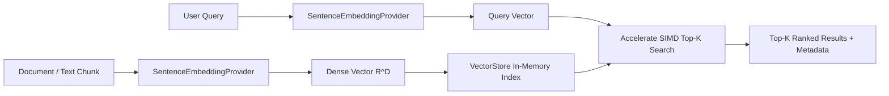

# In-Memory VectorStore & On-Device RAG

Build low-latency semantic search, embedding retrieval, and Retrieval-Augmented Generation (RAG) pipelines on Apple Silicon using SIMD Accelerate.

## Overview

Vector databases are essential for modern semantic search, AI agent memory, and Retrieval-Augmented Generation (RAG). `SwiftCluster` provides `VectorStore`, a thread-safe in-memory vector index optimized with Apple Accelerate SIMD operations (`vDSP_dotprD`, `vDSP_svesqD`, `vDSP_distancesqD`). 

For datasets up to 100,000 vectors, in-memory linear scans accelerated by Apple Silicon unified memory and NEON SIMD registers deliver sub-millisecond retrieval without the complexity, disk overhead, or C++ dependencies of external databases like Chroma or FAISS.



---

## 1. Supported Distance & Similarity Metrics

`VectorStore` supports three fundamental metric spaces via ``VectorMetric``:

| Metric | Enum Case | Range | Ideal Use Case |
|:---|:---|:---:|:---|
| **Cosine Similarity** | `.cosineSimilarity` | `[-1.0, 1.0]` | Normalized or unnormalized text embeddings. Evaluates semantic angular closeness regardless of vector magnitude. |
| **Dot Product** | `.dotProduct` | `(-inf, inf)` | Pre-normalized unit vectors ($\|v\|_2 = 1.0$), maximizing execution speed via direct single-pass multiply-accumulate. |
| **Euclidean Distance** | `.euclideanDistance` | `[0.0, inf)` | Spatial clustering, image feature prints, physical embeddings. Lower values indicate closer proximity. |

```swift
import SwiftCluster

// Initialize with cosine similarity (default)
let store = VectorStore(metric: .cosineSimilarity)
```

---

## 2. Ingesting Vectors & Metadata

Each item in the index is encapsulated in a ``VectorEntry``, storing a unique identifier, the dense numerical vector, and arbitrary string key-value metadata (such as document titles, URLs, timestamps, or raw text content).

### Single Entry Ingestion
```swift
store.add(
    id: "doc_101",
    vector: [0.12, 0.85, -0.44, 0.31],
    metadata: [
        "title": "Apple Silicon Architecture",
        "author": "Engineering Team",
        "category": "hardware"
    ]
)
```

### High-Throughput Batch Ingestion
When ingesting thousands of document chunks, use `addBatch(entries:)` to minimize locking overhead:

```swift
let entries = chunks.enumerated().map { idx, chunk in
    VectorEntry(
        id: "chunk_\(idx)",
        vector: embeddings[idx],
        metadata: ["text": chunk.text, "doc_id": chunk.documentId]
    )
}

store.addBatch(entries: entries)
print("Indexed \(store.count) vectors into VectorStore.")
```

---

## 3. Top-K Semantic Similarity Search

Use `search(query:topK:)` to retrieve the most relevant vectors. The search uses a bounded collection pattern that avoids sorting the entire dataset, maintaining peak performance even as the collection grows.

```swift
// Query with a high-dimensional vector
let queryVector: [Double] = [0.10, 0.82, -0.40, 0.29]

// Retrieve Top-3 nearest neighbors
let results: [VectorSearchResult] = store.search(query: queryVector, topK: 3)

for match in results {
    print("Match ID: \(match.id)")
    print("Similarity Score: \(String(format: "%.4f", match.score))")
    print("Document Title: \(match.metadata["title"] ?? "Unknown")")
    print("---")
}
```

### Relevance Threshold Filtering
In production RAG workflows, avoid hallucination by filtering out retrieved items that fall below a minimum semantic similarity threshold:

```swift
let minimumRelevanceThreshold = 0.70
let relevantHits = results.filter { $0.score >= minimumRelevanceThreshold }

guard !relevantHits.isEmpty else {
    print("No relevant context found above threshold.")
    return
}
```

---

## 4. Index Lifecycle & Thread Safety

`VectorStore` is thread-safe (`@unchecked Sendable`) and guarded by internal `NSLock` synchronization, making it safe to query and update concurrently across Swift `Task` groups and actors.

```swift
// Check existence
let exists = store.contains(id: "doc_101")

// Retrieve raw vector entry
if let entry = store.get(id: "doc_101") {
    print("Retrieved dimension: \(entry.vector.count)")
}

// Remove obsolete documents
let wasRemoved = store.remove(id: "doc_101")

// Purge index
store.clear()
```

---

## 5. Scaling to Large Collections with HNSW

When vector collections grow beyond 100,000 items, linear scans ($O(N)$) may exceed interactive latency budgets. `SwiftCluster` provides ``HNSWIndex`` (Hierarchical Navigable Small World), an approximate nearest neighbor graph offering $O(\log N)$ search latency.

```swift
// Initialize an HNSW graph index
let hnsw = HNSWIndex(
    metric: .cosineSimilarity,
    M: 16,               // Number of bi-directional links per node
    efConstruction: 200, // Search depth during index construction
    efSearch: 50         // Search depth during query time
)

// Ingest into HNSW graph
for entry in entries {
    await hnsw.add(id: entry.id, vector: entry.vector, metadata: entry.metadata)
}

// Sub-millisecond ANN search across 500,000 vectors
let annResults = await hnsw.search(query: queryVector, topK: 5)
```

---

## 6. Persistence & Serialization

Because ``VectorEntry`` and ``VectorSearchResult`` conform to `Codable`, an entire vector store can be saved to disk as compressed JSON or binary Property List, and restored at application launch:

```swift
// Export vector store entries to JSON Data
func exportStore(store: VectorStore) throws -> Data {
    // Collect all entries (or maintain a list during ingestion)
    let encoder = JSONEncoder()
    return try encoder.encode(entries)
}

// Restore store from disk
func importStore(from data: Data) throws -> VectorStore {
    let decoder = JSONDecoder()
    let loadedEntries = try decoder.decode([VectorEntry].self, from: data)
    let store = VectorStore(metric: .cosineSimilarity)
    store.addBatch(entries: loadedEntries)
    return store
}
```

---

## 7. Complete On-Device Semantic Search Example

```swift
import SwiftCluster
import SwiftNLP

// 1. Initialize sentence embedding provider and vector store
let embeddingEngine = try AppleSentenceEmbeddingEngine(language: .english)
let vectorStore = VectorStore(metric: .cosineSimilarity)

// 2. Sample documents to index
let corpus = [
    "SwiftSci utilizes Apple Accelerate SIMD kernels for linear algebra.",
    "MLX provides unified memory GPU tensor computation on macOS.",
    "Autoregressive LLM decoders leverage KV-caches to optimize throughput.",
    "Pandas-like DataFrame operations in Swift support typed column queries."
]

// 3. Vectorize and ingest corpus
for (idx, text) in corpus.enumerated() {
    let vector = try embeddingEngine.embed(text)
    vectorStore.add(
        id: "doc_\(idx)",
        vector: vector,
        metadata: ["content": text]
    )
}

// 4. Query vector store
let query = "How does SwiftSci accelerate vector operations?"
let queryVector = try embeddingEngine.embed(query)
let topMatches = vectorStore.search(query: queryVector, topK: 1)

if let bestMatch = topMatches.first {
    print("Top match (Score: \(bestMatch.score)):")
    print(bestMatch.metadata["content"] ?? "")
}
```

---

## Topics

### Vector Store Types
- ``VectorStore``
- ``VectorEntry``
- ``VectorSearchResult``
- ``VectorMetric``
- ``HNSWIndex``
