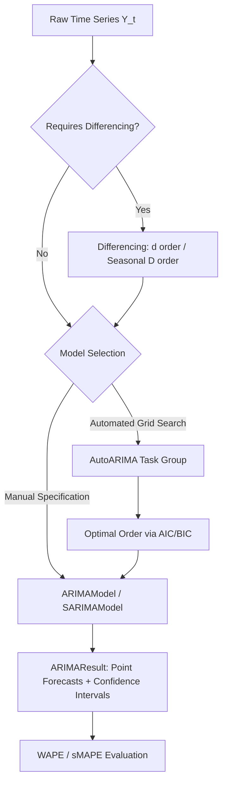

# ARIMA & SARIMA Time Series Models

Forecast univariate time series with trends and periodic seasonalities using Autoregressive Integrated Moving Average (ARIMA), Seasonal ARIMA (SARIMA), and Automated Order Selection (AutoARIMA).

## Overview

Time series observations often display temporal autocorrelation, stochastic drift, and repetitive seasonal cycles. `SwiftForecast` provides high-performance, actor-isolated statistical models optimized with Apple Accelerate SIMD linear algebra:

1. **``ARIMAModel``**: Models non-seasonal series using $(p, d, q)$ specifications with vectorized two-stage Hannan-Rissanen conditional least-squares parameter estimation.
2. **``SARIMAModel``**: Extends ARIMA to capture multiplicative seasonal cycles $(p, d, q) \times (P, D, Q)_s$ via polynomial cross-term refinement.
3. **``AutoARIMA``**: Performs parallelized grid search over potential order permutations, selecting optimal configurations via AIC or BIC criteria.



---

## 1. Non-Seasonal ARIMA Modeling

An $\text{ARIMA}(p, d, q)$ model combines:
- **$p$ (Autoregressive Order)**: Dependence on preceding $p$ lagged values.
- **$d$ (Differencing Order)**: Degree of differencing required to achieve weak stationarity.
- **$q$ (Moving Average Order)**: Dependence on preceding $q$ white-noise forecast errors.

### Fitting and Multi-Step Forecasting

```swift
import SwiftForecast

// 1. Initialize historical series (e.g., monthly sales)
let monthlySales: [Double] = [
    112, 118, 132, 129, 121, 135, 148, 148, 136, 119, 104, 118,
    115, 126, 141, 135, 125, 149, 170, 170, 158, 133, 114, 140
]

// 2. Initialize actor-isolated ARIMA(1, 1, 1) model
let arima = try ARIMAModel(p: 1, d: 1, q: 1)

// 3. Fit parameters via Hannan-Rissanen conditional least-squares
try await arima.fit(series: monthlySales)

// 4. Generate out-of-sample forecast for next 6 horizons
let result = try await arima.forecast(horizon: 6)

print("Point Forecasts: \(result.pointForecasts)")
if let lower = result.lowerConfidenceInterval, let upper = result.upperConfidenceInterval {
    for i in 0..<result.pointForecasts.count {
        print("t+\(i + 1): \(String(format: "%.1f", result.pointForecasts[i])) [95% CI: \(String(format: "%.1f", lower[i])) – \(String(format: "%.1f", upper[i]))]")
    }
}
```

---

## 2. Seasonal SARIMA Modeling

When data exhibits recurring seasonal patterns (such as quarterly retail spikes or 24-hour diurnal rhythms), standard non-seasonal differencing is insufficient.

``SARIMAModel`` incorporates multiplicative seasonal operators:

$$(p, d, q) \times (P, D, Q)_s$$

where:
- **$s$**: Seasonal period length ($s=4$ for quarterly, $s=12$ for monthly, $s=7$ for daily data).
- **$P, D, Q$**: Seasonal autoregressive, seasonal differencing, and seasonal moving-average orders.

```swift
import SwiftForecast

// Initialize SARIMA(1, 1, 1) x (1, 1, 0)_12 for monthly seasonal data
let sarima = try SARIMAModel(
    p: 1, d: 1, q: 1,
    P: 1, D: 1, Q: 0,
    s: 12
)

try await sarima.fit(series: monthlySales)

// Forecast 12 months ahead
let seasonalForecast = try await sarima.forecast(horizon: 12)
print("12-Month Ahead Forecast: \(seasonalForecast.pointForecasts)")
```

---

## 3. Automated Order Selection (`AutoARIMA`)

Determining optimal $(p, d, q)$ and $(P, D, Q)_s$ orders manually through autocorrelation (ACF) and partial autocorrelation (PACF) plots can be labor-intensive. ``AutoARIMA`` evaluates an exhaustive or bounded grid concurrently across Apple Silicon CPU cores, penalizing complexity with AIC or BIC:

```swift
import SwiftForecast

// Initialize automated grid search engine
let autoArima = AutoARIMA(
    maxP: 3,
    maxD: 2,
    maxQ: 3,
    seasonal: true,
    seasonalPeriod: 12,
    criterion: .aic
)

// Search across candidate permutations
let searchResult = try await autoArima.fit(series: monthlySales)

print("Selected Optimal Order: \(searchResult.bestOrder)")
// Example: SARIMA(1, 1, 1)(0, 1, 1)[12]
print("Optimal AIC Score: \(searchResult.bestScore)")

// Forecast directly using the winning model
let bestForecast = try await searchResult.forecast(horizon: 6)
print("Best Forecast: \(bestForecast.pointForecasts)")
```

---

## 4. Forecasting Accuracy with `TimeSeriesMetrics`

Validate predictions against holdout test folds using standard metric evaluators, including Weighted Absolute Percentage Error (WAPE):

```swift
import SwiftForecast

let actuals: [Double] = [150.0, 162.0, 180.0, 175.0, 160.0, 142.0]
let predictions = result.pointForecasts

let wapeError = TimeSeriesMetrics.wape(actual: actuals, forecast: predictions)
let smapeError = TimeSeriesMetrics.smape(actual: actuals, forecast: predictions)
let rmseError = TimeSeriesMetrics.rmse(actual: actuals, forecast: predictions)

print("WAPE: \(String(format: "%.2f%%", wapeError * 100))")
print("sMAPE: \(String(format: "%.2f%%", smapeError * 100))")
print("RMSE: \(String(format: "%.2f", rmseError))")
```

---

## Topics

### Forecasting Models
- ``ARIMAModel``
- ``SARIMAModel``
- ``AutoARIMA``
- ``AutoARIMAOrder``
- ``TimeSeriesMetrics``
